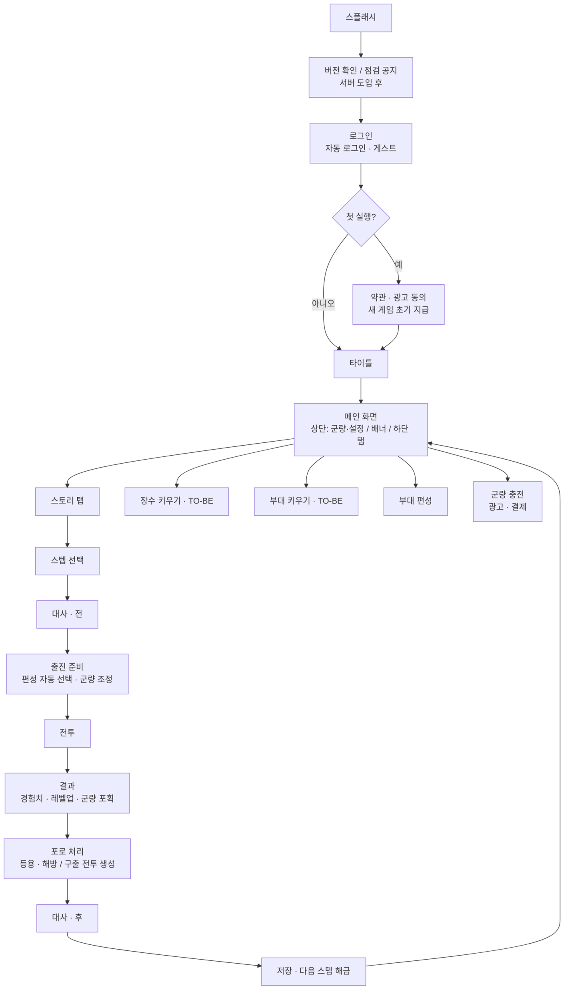

# 전체 플로우

> 상태: 기획 확정 (구현 전)
> 게임 전체의 큰 흐름과, 각 단계를 맡는 문서·모듈을 정리한다.
> **큰 흐름은 고정하고, 각 단계(탭·컨텐츠)는 모듈 단위로 교체**할 수 있게 만든다. 테마(삼국지 → 판타지 등) 교체는 [theme.md](theme.md).

---

## 1. 전체 흐름도



텍스트 요약:

```
앱 시작:  스플래시 → (버전 확인) → 로그인 → (첫 실행: 약관·초기 지급) → 타이틀 → 메인
메인:     상단(군량·충전·설정) / 띠 배너 / 하단 탭(스토리·장수·부대·편성)
진행 루프: 스텝 선택 → 대사 → 출진 준비 → 전투 → 결과 → 포로 처리 → 대사 → 저장 → 메인
성장 루프: 결과(경험치·해금) → (키우기 탭, TO-BE) → 편성 → 다음 출진
```

---

## 2. 단계별 정리

| # | 단계 | 내용 | 문서 | 상태 |
|---|---|---|---|---|
| 1 | 스플래시·로그인·약관 | 자동 로그인, 게스트, 계정 연동, 약관·광고 동의 | [content/startup.md](content/startup.md) | Step 1 |
| 2 | 새 게임 초기 지급 | 장수 3명, 군단, 진형, 시작 군량, 기본 편성 | [content/formation.md](content/formation.md) | Step 1 |
| 3 | 메인 화면 | 상단 바, 띠 배너, 하단 탭, 설정 | [content/main-screen.md](content/main-screen.md) | Step 1 |
| 4 | 스토리 탭 | 스텝 목록, 대사, 출진 준비 | [content/story.md](content/story.md) | Step 1~2 |
| 5 | 부대 편성 탭 | 군단 구성, 상황별 편성 | [content/formation.md](content/formation.md) | Step 1~2 |
| 6 | 전투 | 실시간 군단 지휘 | [content/battle.md](content/battle.md) | Step 2 (웹 2D 검증 후 Unity) |
| 7 | 결과·포로 처리 | 경험치·레벨업, 군량 포획, 등용·해방, 구출 | [content/captivity.md](content/captivity.md), [content/economy.md](content/economy.md) | Step 2 |
| 8 | 장수 키우기 | 능력치·스킬 성장 | [content/general-growth.md](content/general-growth.md) | TO-BE |
| 9 | 부대 키우기 | 병종 승급, 진형 해금 | [content/troop-growth.md](content/troop-growth.md) | TO-BE |
| 10 | 군량·결제 | 군량 획득·소비, 결제 상품 | [content/economy.md](content/economy.md) | 표시 Step 1, 결제 이후 |
| 11 | 광고 | 띠 배너, 보상형 광고, 광고 제거 | [content/ads.md](content/ads.md) | 이후 |
| 12 | 서버 | 결제 검증, 서버 시간, 클라우드 세이브 | [planning-notes.md](planning-notes.md) 8장 | 출시 전 |

---

## 3. 세이브 데이터가 바뀌는 지점

| 시점 | 바뀌는 것 |
|---|---|
| 새 게임 | 장수 3명, 군단, 배운 진형·스킬, 시작 군량, 기본 편성 |
| 편성 저장 | 상황별 편성 |
| 출진 | 보유 군량 − 지참 군량 |
| 전투 종료 | 장수 경험치·레벨, 남은 지참 군량 반환 + 포획 군량, 장수 상태(포로) |
| 포로 처리 | 등용된 장수 추가, 감금 중인 적 장수, 구출 전투 생성 |
| 스텝 클리어 | 다음 스텝 해금, 보상(진형·스킬) |
| 광고·결제 | 군량, 광고 제거 권한 |
| 시간 경과 | 구출 기한 → 자동 석방, 등용 재시도 가능, (패키지) 군량 회복 |

---

## 4. 모듈 경계 (교체 단위)

각 단계는 **정해진 입력을 받아 정해진 출력을 내는 모듈**이다. 모듈 안을 바꿔도 흐름은 그대로다.

| 모듈 | 입력 | 출력 | 교체 예 |
|---|---|---|---|
| 앱 시작 (`StartupFlow`) | - | 로그인된 계정 | 로그인 수단 추가, 서버 로그인 |
| 메인 탭 (`IMainTab`) | 세이브 상태 | 세이브 상태 변경 / 출진 요청 | 탭 추가·교체·순서 변경 (`mainTabs.json`) |
| 스토리 (`StoryTab`, `StepFlow`) | 스텝 데이터, 진행 상태 | 선택한 스텝 | 전략 지도 방식으로 교체 |
| 출진 준비 (`SortiePrepScreen`) | 스텝 + 편성 + 군량 | `BattleSetup` | |
| **전투** | `BattleSetup` | `BattleResult` | 전투 방식 자체 교체도 가능 (입출력만 유지) |
| 결과 처리 (Progression, Campaign, Economy) | `BattleResult` | 세이브 상태 변경 | 보상 규칙 변경 |
| 테마 (`ThemeManager`) | 테마 id | 이름·그림·대사 | 삼국지 → 판타지 |

```
[스토리/전략 지도] ──스텝──▶ [출진 준비] ──BattleSetup──▶ [전투] ──BattleResult──▶ [결과 처리] ──▶ 세이브
        ▲                                                                                    │
        └────────────────────────────── 메인 화면 ◀───────────────────────────────────────────┘
```

---

## 5. 교체 방법 요약

| 바꾸고 싶은 것 | 방법 | 기존 코드 수정 |
|---|---|---|
| 탭 추가·교체 | `IMainTab` 구현 + `mainTabs.json` | 없음 |
| 탭 컨텐츠 내용 | 해당 탭 모듈과 데이터만 수정 | 다른 탭·전투 없음 |
| 스텝·대사 | JSON 추가·교체 | 없음 |
| 진행 방식 (스토리 → 전략 지도) | 새 모듈이 `BattleSetup` 생성, `BattleResult` 처리 | 전투 없음 |
| 테마 (삼국지 → 판타지) | 테마 팩 교체 ([theme.md](theme.md)) | 없음 (새 규칙이 필요하면 확장 지점에 추가) |
| 언어 | 문자열 표 추가 | 없음 |

---

## 6. 문서 지도

```
docs/
├─ README.md            문서 목록
├─ flow.md              ← 이 문서 (전체 흐름)
├─ planning-notes.md    논의·결정 기록
├─ architecture.md      코드 구조 (Unity)
├─ theme.md             테마 교체 원칙
├─ review.md            검토 메모
└─ content/             단계·탭별 컨텐츠
    ├─ startup.md        앱 시작·로그인
    ├─ main-screen.md    메인 화면
    ├─ story.md          스토리 탭·출진
    ├─ formation.md      부대 편성·초기 지급
    ├─ battle.md         전투
    ├─ captivity.md      포로·구출·등용
    ├─ general-growth.md 장수 키우기 (TO-BE)
    ├─ troop-growth.md   부대 키우기 (TO-BE)
    ├─ economy.md        군량·결제
    └─ ads.md            광고
```
